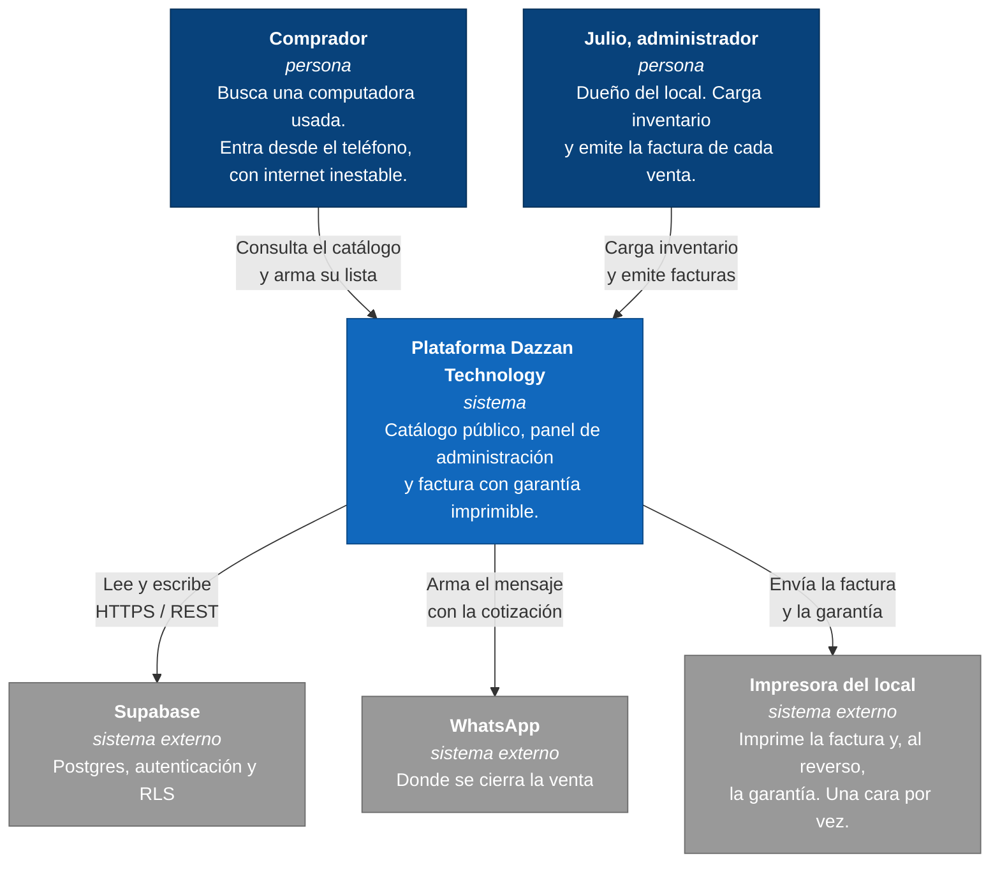
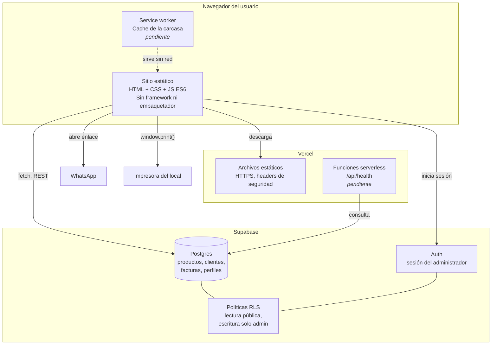
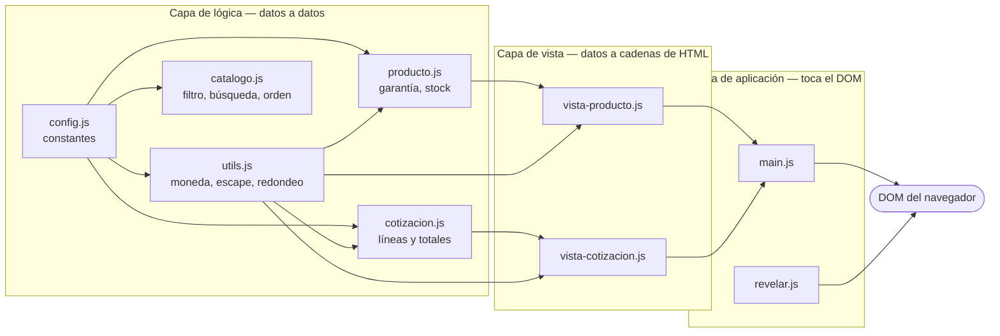
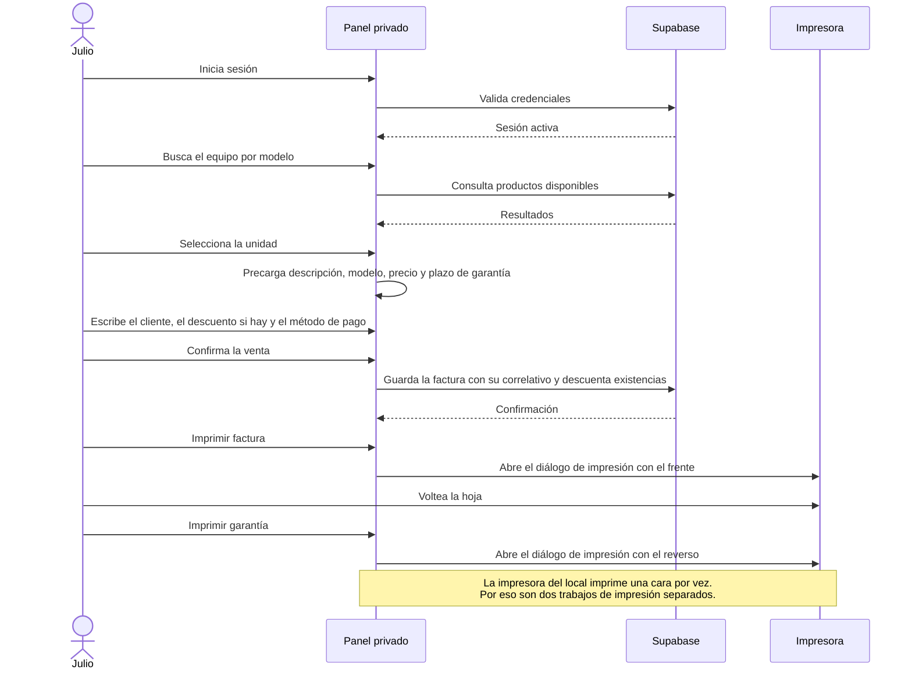

# Arquitectura

Documento de arquitectura de la plataforma web de Dazzan Technology, en los
tres primeros niveles del modelo C4: contexto, contenedores y componentes.

**Estado al 12 de noviembre de 2026.** Este documento describe la arquitectura
objetivo. No todo está construido todavía. La tabla siguiente separa lo que ya
corre de lo que está decidido pero pendiente, para que nadie lea el diagrama
como si fuera un inventario de lo que existe hoy.

| Pieza | Estado |
|---|---|
| Catálogo público, filtros, búsqueda y lista de cotización | Construido |
| Capa de lógica pura con 90 pruebas | Construido |
| Integración continua en GitHub Actions | Construido |
| Configuración de despliegue en Vercel (headers, 404, healthcheck) | Construido, sin publicar |
| Base de datos en Supabase | Pendiente |
| Autenticación y portal privado | Pendiente |
| Factura y hoja de garantía imprimibles | Pendiente |

---

## Nivel 1 — Contexto

Quién usa el sistema y con qué sistemas externos habla.

El datáfono del local no aparece porque no interviene: es uno de los medios de
pago y no guarda relación con la factura (RN-09). El cobro ocurre fuera del
sistema; lo que el sistema registra es con qué método se pagó.

---

## Nivel 2 — Contenedores

Las piezas desplegables y cómo se comunican.

El navegador habla con Supabase directamente por su API REST, sin servidor
propio en medio. Lo que protege los datos no es una capa intermedia sino las
políticas RLS de Postgres, que se aplican del lado del servidor y no se pueden
esquivar desde el cliente. Esa es la razón de que la llave pública pueda viajar
al navegador sin que eso sea una fuga.

---

## Nivel 3 — Componentes del sitio

Las tres capas del código, y cuál de ellas cruza al navegador.

La frontera está en la capa de aplicación: `main.js` y `revelar.js` son los
únicos dos archivos del proyecto que mencionan `document`. Todo lo que está a
su izquierda se prueba sin navegador y sin simular el DOM, y por eso las 90
pruebas corren en menos de medio segundo.

Las dependencias apuntan en una sola dirección. La lógica no conoce a la vista
y la vista no conoce a la aplicación. Un cambio de presentación nunca obliga a
tocar una regla de negocio.

---

## Flujo principal: la venta con factura y garantía

Es el recorrido que justifica el proyecto. Hoy Julio arma cada factura a mano
en una plantilla y escribe todos los datos del equipo.

El producto vendido no se borra. Si se borrara, la factura guardada se quedaría
apuntando a un registro inexistente y Julio no podría consultarla cuando el
cliente vuelva a reclamar la garantía. Está razonado en el ADR-002.

---

## Decisiones relacionadas

| Documento | Decisión |
|---|---|
| [ADR-001](adr/ADR-001-backend-gestionado.md) | Usar Supabase gestionado en vez de levantar un backend propio |
| [ADR-002](adr/ADR-002-productos-vendidos.md) | Marcar los productos vendidos en vez de borrarlos |
| `DECISIONES.md` DT-01 | JavaScript modular sin framework |
| `DECISIONES.md` DT-04 | Lógica pura separada del DOM |
| `DECISIONES.md` DT-07 | Alojar en Vercel y resolver el backend con Supabase |
| `DECISIONES.md` DT-08 | El documento que emite el sistema es la factura del negocio |
| `DECISIONES.md` DT-10 | El correlativo se configura al arrancar y nunca se reutiliza |

## Atributos de calidad que condicionaron el diseño

| Atributo | Por qué importa aquí | Cómo se atiende |
|---|---|---|
| Funcionar con internet inestable | Los compradores entran desde el teléfono, con datos móviles | Sin framework, sin empaquetador, imágenes en WebP, service worker |
| Que el panel no requiera capacitación | Julio puede contratar a alguien y no va a dar un curso | Una sola pantalla con un buscador; las etiquetas usan las mismas palabras que su factura |
| Que los datos privados no se filtren | El catálogo es público, las ventas y los clientes no | RLS en Postgres, no validación en el navegador |
| Poder consultar una factura meses después | La garantía dura 3 meses y el cliente vuelve a reclamar | Los productos vendidos se conservan, no se borran |
| Costo cero de operación | Es una tienda de una persona | Planes gratuitos de Vercel y Supabase |
